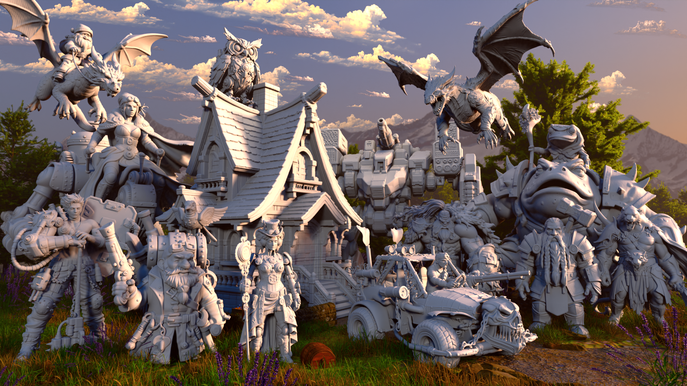

# Direct3D-V3: Latent-Free Diffusion Transformers in the Native Voxel Domain

<div align="center">

**ACM Transactions on Graphics (SIGGRAPH Asia 2026)**

Shuang Wu<sup>1,2</sup>, Jiachen Qian<sup>2,3</sup>, Youtian Lin<sup>1</sup>, Feihu Zhang<sup>2</sup>, Philip Torr<sup>4</sup>, Yao Yao<sup>1</sup>, and Xun Cao<sup>1</sup>

<sup>1</sup>Nanjing University &nbsp; <sup>2</sup>DreamTech &nbsp; <sup>3</sup>The University of Hong Kong &nbsp; <sup>4</sup>University of Oxford

<a href="https://dreamtechai.github.io/Direct3D-V3"></a>
<a href="https://huggingface.co/spaces/wushuang98/Direct3D-V3"></a>
<a href="https://huggingface.co/wushuang98/Direct3D-V3"></a>
<a href="https://dl.acm.org/doi/10.1145/3842524"></a>
<a href="https://arxiv.org/abs/2611.26511"></a>

</div>



Direct3D-V3 generates diverse, high-fidelity 3D meshes by modeling raw SDF voxel grids directly with latent-free diffusion transformers, removing the VAE bottleneck used by latent diffusion pipelines.

> **The released model generates meshes with substantially finer surface detail than the version evaluated in the paper.** For image conditioning, we now combine features from four DINOv3 layers. Switching to the Muon optimizer both accelerated training convergence and improved the quality of the generated meshes.

## News

- **2026.11.19**: Inference code and models are released.
- **2026.11.19**: The [project page](https://dreamtechai.github.io/Direct3D-V3) and [paper](https://dl.acm.org/doi/10.1145/3842524) are released.
- **2026.08.25**: Direct3D-V3 is accepted to ACM Transactions on Graphics (SIGGRAPH Asia 2026).

## TODO

- ✅ Release the inference code and models.
- ✅ Release [VecShape](https://github.com/DreamTechAI/VecShape), our Stage 1 coarse mesh generator.
- [ ] Release the latent-free texture generation model.
- [ ] Release the training code.

## Input preparation

### Coarse mesh

By default, `infer.py` uses VecShape to generate a coarse mesh from the reference image, then passes that mesh directly to the Direct3D-V3 cascade. At the default resolution of 1024, the cascade runs the 512 and 1024 stages in order. Choose 1536 to add the final stage.

To refine your own mesh, pass an aligned OBJ, GLB, or PLY with `--coarse-mesh`. Direct3D-V3 then uses your reference image directly and skips both VecShape and Qwen.

### Reference image

For richer geometric detail, we recommend preparing a **surface normal map or white clay image** from your RGB input with **ChatGPT (GPT Image 2.5)**. [Lotus-2](https://github.com/EnVision-Research/Lotus-2) is another option for predicting surface normal maps. Preserve the original viewpoint, silhouette, proportions, and as much fine geometry as possible, including small grooves, sharp edges, and thin structures. Detailed geometric cues in the conditioning image help Direct3D-V3 generate meshes with finer surface detail.

Use the original RGB image for VecShape and the aligned normal map or white clay render for Direct3D-V3. For a clay render, see [Texture removal with Qwen-Image-2.1-Turbo](#texture-removal-with-qwen-image-21-turbo).

## Installation

The demo uses Python 3.12, PyTorch 2.14.1, and CUDA 13.0 on Linux. Install the CUDA 13.0 toolkit and a C++20 compiler before building the GPU extensions.

```bash
git clone https://github.com/DreamTechAI/Direct3D-V3.git
cd Direct3D-V3
conda create -n direct3d-v3 python=3.12 -y
conda activate direct3d-v3

pip install torch==2.14.1 torchvision==0.29.1 --index-url https://download.pytorch.org/whl/cu130
pip install -r requirements.txt gradio==6.32.0 setuptools wheel packaging psutil ninja

# Install FlashAttention 2 with C++20 support for PyTorch 2.14
CXXFLAGS="-std=c++20" pip install --no-build-isolation \
    git+https://github.com/Dao-AILab/flash-attention.git@edb5c76ee329b18ed95d1f7ea9aa522a1331ab7d

# Install voxelization and hole filling
pip install --no-build-isolation ./third_party/voxelization ./third_party/fill_holes

# Install VecShape for the demo and for CLI inference without --coarse-mesh
pip install git+https://github.com/DreamTechAI/VecShape.git
```

## Model weights

`infer.py` and `app.py` load weights from `wushuang98/Direct3D-V3` on Hugging Face by default. Use `--model` to select another Hub repository or a local model directory.

Both entry points load `wushuang98/VecShape` by default for coarse mesh generation. Use `--vecshape-model` to select another Hub repository or a local model directory.

The model directory should have the following layout:

```text
config.json
model_index.json
shape_transformers_512/
    config.json
    model.safetensors
shape_transformers_1024/
    config.json
    model.safetensors
shape_transformers_1536/
    config.json
    model.safetensors
```

`from_pretrained` reads the `model_index` path from the root `config.json`, then loads each denoiser with the architecture and sampling settings in its own directory. Earlier releases use `model_index.json` directly. Calling `.to("cuda")` places all three denoisers on the selected GPU. Pass `revision=` to pin the model repository's weights and configs together.

The `image_encoder` field in `model_index.json` selects the DINOv3 encoder. It accepts a Hugging Face model ID or a directory in the same model repository such as `./image_encoder`.

## Inference

VecShape builds a coarse mesh from the original image. Qwen-Image-2.1-Turbo turns the same image into a white clay render, which guides the 512 and 1024 stages of Direct3D-V3. **The default command uses Qwen under its research license. Commercial use of Qwen requires separate permission from its publisher.** [Qwen Research License Agreement](https://huggingface.co/Qwen/Qwen-Image-2.1-Turbo/blob/main/LICENSE)

```bash
python infer.py --image assets/input_imgs/6.png
```

The command saves `output.glb` by default. Add `--no-enhance` to use the original image for both VecShape and Direct3D-V3. If you already have an aligned mesh, pass it with `--coarse-mesh`.

```bash
python infer.py --image assets/input_imgs/6_normal.png --coarse-mesh assets/coarse_meshes/6.obj
```

### Python inference

Use the original RGB image for VecShape and its aligned normal map for Direct3D-V3. The coarse mesh stays in memory.

```python
import trimesh
from direct3d import Direct3DV3Pipeline
from vecshape import VecShapePipeline

vecshape = VecShapePipeline.from_pretrained("wushuang98/VecShape").to("cuda")
shape = vecshape("assets/input_imgs/6.png", seed=2026)
coarse = trimesh.Trimesh(shape.vertices, shape.faces, process=False)
del vecshape

pipeline = Direct3DV3Pipeline.from_pretrained("wushuang98/Direct3D-V3").to("cuda")
pipeline("assets/input_imgs/6_normal.png", coarse, resolution=1024, seed=2026).export("generated.glb")
```

### Texture removal with Qwen-Image-2.1-Turbo

From the repository root, use the same RGB image for VecShape and Qwen Turbo. The Turbo checkpoint supplies its eight-step sampling schedule. Direct3D-V3 combines the coarse mesh with Qwen’s white clay render. [Qwen license notes](#license)

```python
from pathlib import Path

import torch
import trimesh
from diffusers import QwenImage21Pipeline
from direct3d import Direct3DV3Pipeline
from PIL import Image
from vecshape import VecShapePipeline

image = Image.open("assets/input_imgs/6.png")
vecshape = VecShapePipeline.from_pretrained("wushuang98/VecShape").to("cuda")
shape = vecshape(image, seed=2026)
coarse = trimesh.Trimesh(shape.vertices, shape.faces, process=False)
del vecshape

editor = QwenImage21Pipeline.from_pretrained("Qwen/Qwen-Image-2.1-Turbo", torch_dtype=torch.bfloat16)
editor.enable_model_cpu_offload()
prompt = Path("assets/prompt.txt").read_text(encoding="utf-8").strip()
clay = editor(image=image, prompt=prompt, width=1280, height=1280, generator=torch.Generator("cuda").manual_seed(2026)).images[0]
del editor

pipeline = Direct3DV3Pipeline.from_pretrained("wushuang98/Direct3D-V3").to("cuda")
pipeline(clay, coarse, resolution=1024, seed=2026).export("generated.glb")
```

### Inference options

- **Batch input.** Pass `--image ./rgb_images --output ./generated`. Each mesh is generated and saved before processing the next image. For custom meshes, add `--coarse-mesh ./coarse_meshes` with matching filenames such as `chair.png` and `chair.obj`.
- **Sampling.** Each Direct3D-V3 stage defaults to 15 steps and CFG 4.0. Use `--steps-1024` and `--cfg-1024` to override just that resolution, or `--steps` and `--cfg` for all active resolutions. In Python, pass a resolution-keyed dictionary such as `num_inference_steps={1024: 20}` or `guidance_scale={1024: 5.0}`.
- **GPU memory.** If you run out of memory, lower `--max-tokens` (`max_tokens` in Python) from its default of 150,000. Fewer tokens can reduce fine surface detail.
- **Triangle count.** The default target is 2 million faces. Set `--target-faces` to change it or `--no-simplify` to keep all faces (`target_faces=None` in Python).
- **Single checkpoint.** Use `--checkpoint ./model.safetensors --resolution 512` to run just the 512 stage after VecShape. To start from an existing mesh, also supply `--coarse-mesh`. Use `--model` to override the checkpoint's config repository.

## Gradio demo

Launch the demo, then open the URL printed by Gradio.

```bash
python app.py
```

Upload an RGB image or select an example, choose a resolution, and click **Generate**. VecShape generates the coarse mesh from the original image. **Enhance image with Qwen Turbo** is on by default and creates a white clay reference for Direct3D-V3. Turn it off to use the original image for both models. The foreground preview shows the reference used by Direct3D-V3 after background removal. [Qwen license terms](#license)

Inspect the generated mesh in **White clay** or **Normal** view and download the GLB. Under **Sampling and mesh options**, you can adjust per-stage steps and CFG or set a triangle target from 100,000 to 5 million (default 2 million).

## Citation

```bibtex
@article{wu2026direct3dv3,
  title   = {{Direct3D-V3}: Latent-Free Diffusion Transformers in the Native Voxel Domain},
  author  = {Wu, Shuang and Qian, Jiachen and Lin, Youtian and Zhang, Feihu and
             Torr, Philip and Yao, Yao and Cao, Xun},
  journal = {ACM Transactions on Graphics},
  year    = {2026},
  volume  = {45},
  number  = {6},
  articleno = {244},
  doi     = {10.1145/3842524}
}
```

## License

The Direct3D-V3 source is released under the MIT License. External weights and dependencies retain their respective licenses. [MIT License](LICENSE)

The CLI and Gradio demo use Qwen-Image-2.1-Turbo by default to prepare a reference image during inference. Its weights are downloaded from Qwen's repository. The Qwen Research License permits non-commercial research or evaluation. Commercial use of Qwen requires a separate license from its publisher. If you use Qwen or its outputs to create, train, fine-tune, or improve a model that you make available to others, section 4(b) also requires attribution in that model's documentation. [Qwen Research License Agreement](https://huggingface.co/Qwen/Qwen-Image-2.1-Turbo/blob/main/LICENSE)
